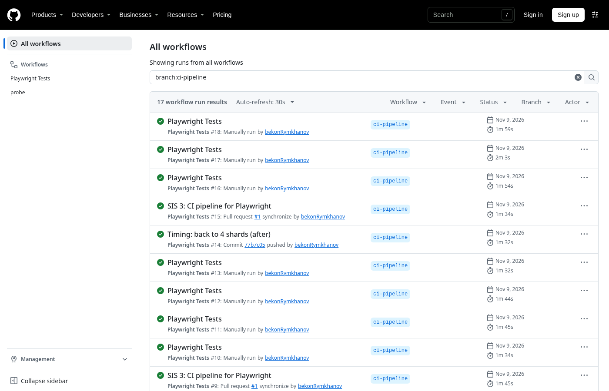
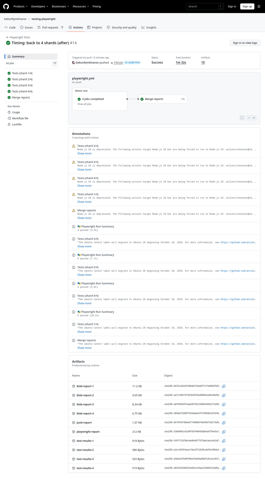
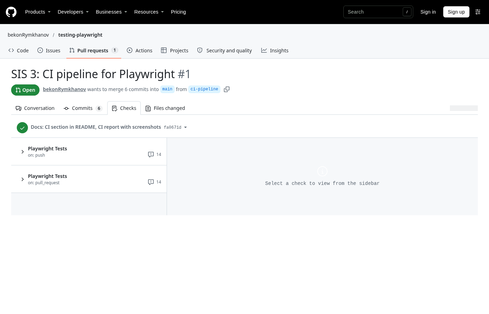
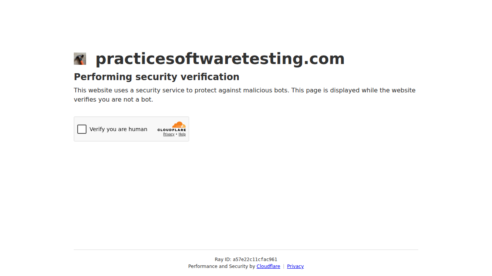
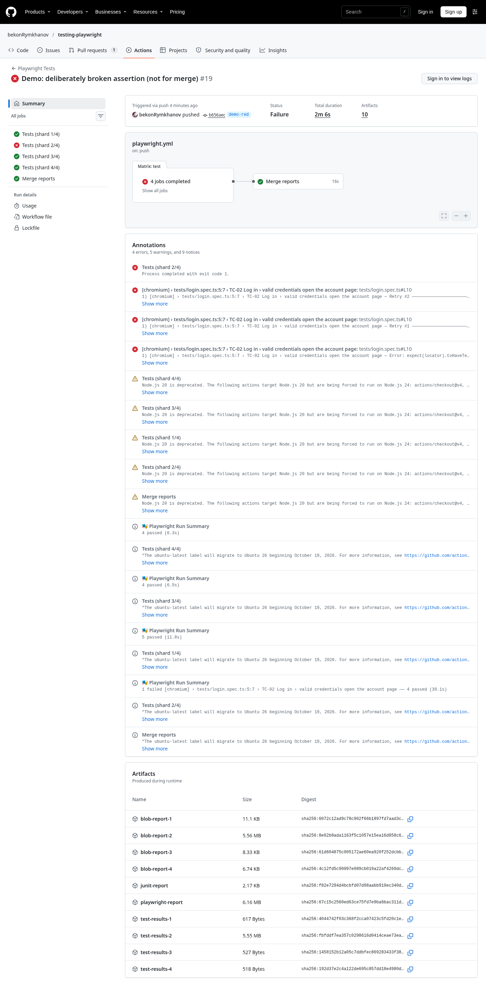
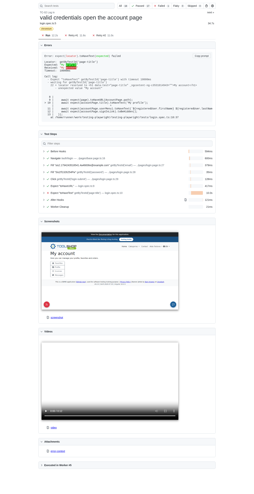
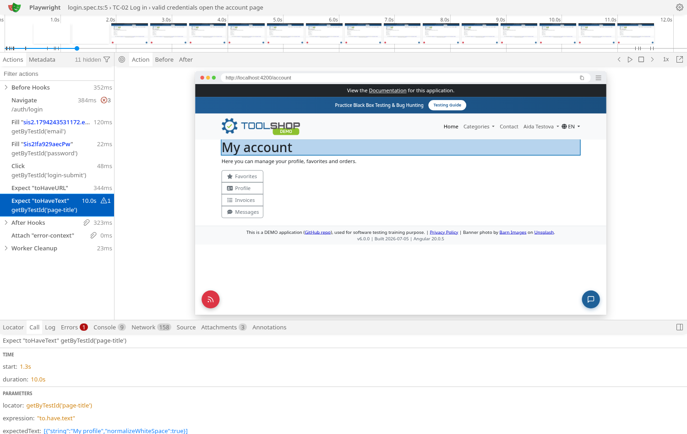
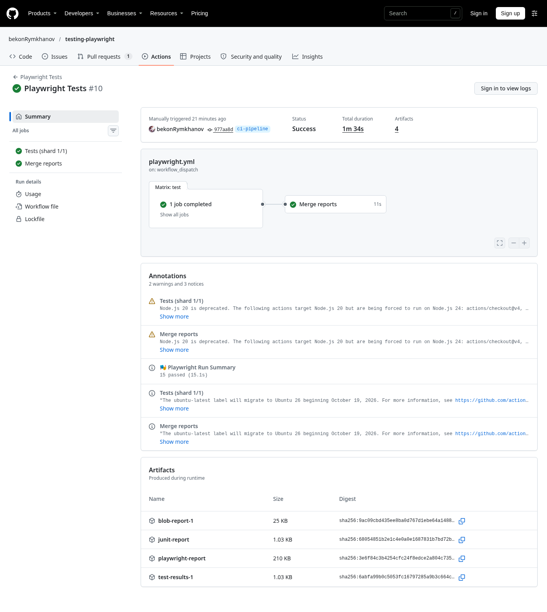
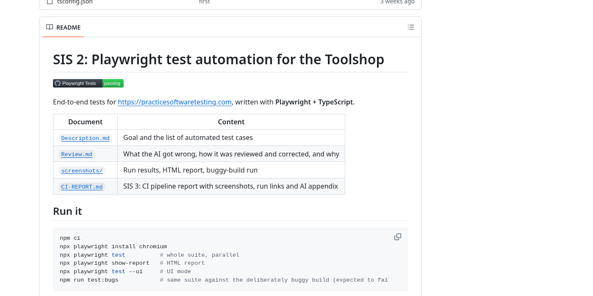

# SIS 3: CI pipeline for Playwright — report

Repository: <https://github.com/bekonRymkhanov/testing-playwright> ·
Pull request: [#1](https://github.com/bekonRymkhanov/testing-playwright/pull/1) ·
CI system: **GitHub Actions** (reason in [README → CI](README.md#ci))

## Summary

| # | Requirement | Done with | Evidence |
|---|---|---|---|
| 1 | Runs on every push and PR | `on: push`, `pull_request` (no branch filter), `workflow_dispatch` | [push run](https://github.com/bekonRymkhanov/testing-playwright/actions/runs/42656366355), [PR run](https://github.com/bekonRymkhanov/testing-playwright/actions/runs/42656374517), screenshot 1 |
| 2 | Cached deps, browsers, full suite | `setup-node` `cache: npm`, `npm ci`, `npx playwright install --with-deps chromium`, `npx playwright test --shard=i/4` (no `--grep` / `--project`) | job log: `Cache restored from key: node-cache-Linux-x64-npm-…`; screenshot 2 |
| 3 | HTML report + traces as artefacts, ≥ 7 days | `upload-artifact`, `retention-days: 14`, `trace: 'on-first-retry'` | `playwright-report`, `test-results-1..4`, `junit-report`; screenshots 2, 5, 6 |
| 4 | CI-specific configuration | `CI` set → `forbidOnly`, `retries: 2`, `workers: 2`, `junit` + `blob` + `github` reporters | `playwright.config.ts`; `test.only` check below |
| 5 | Parallelism + runtime before/after | 4-shard matrix + `Merge reports` job | screenshots 2, 4; table in [README → Runtime](README.md#runtime) |
| 6 | Status badge for `main` | `badge.svg?branch=main` in README | screenshot 7 |

Files added or changed: `.github/workflows/playwright.yml`, `playwright.config.ts`, `merge.config.ts`,
`docker-compose.ci.yml`, `docker/nginx.conf`, `scripts/start-app.sh`, `.gitignore`, `README.md`.

## 1. Runs on push and on pull request

Every push to `ci-pipeline` started a *push* run, and every push to the open PR started a *pull request*
run. The list also shows the manual (`workflow_dispatch`) runs used for timing.



## 2. Green run: 4 parallel shards, merge job, artefacts

The four `Tests (shard i/4)` jobs run at the same time, and `Merge reports` starts after them. All 10 artefacts are
listed at the bottom: per-shard blobs (1 day), `test-results-1..4`, `playwright-report` and
`junit-report` (14 days).



Excerpt from the shard 1 log (the log itself needs a GitHub sign-in to view):

```
Run actions/setup-node@v4
  Cache restored successfully
  Cache restored from key: node-cache-Linux-x64-npm-ed2c10e0…
Run npx playwright test --shard=1/4
  5 passed (12.6s)
```

The PR shows the same checks:



## 3. The first run was red, and the artefacts explained why

The first pipeline ([run](https://github.com/bekonRymkhanov/testing-playwright/actions/runs/42653406956))
failed in every shard: the log-in `setup` timed out waiting for the e-mail field. The failure screenshot
in `test-results-1` and `error-context.md` showed why. The public site sends GitHub's runners a Cloudflare
bot check instead of the page:



A one-off probe confirmed it: from the runner, even `curl https://practicesoftwaretesting.com/auth/login`
gets **403**, and the same request from home gets 200. Headed mode or a different browser channel would
not help with an IP block. So CI now starts the same app from its official Docker images (pinned `2.5`)
and runs the tests against `localhost`. The next attempt also failed, and the `app.log` artefact showed
`web-1 | exec /docker-entrypoint.sh: exec format error`: the published nginx image is ARM-only. It was
replaced by the official `nginx:1.27-alpine` with the app's own config (`docker/nginx.conf`), and the
pipeline went green.

## 4. Useful when red: a deliberately broken test

On a throwaway branch `demo-red` one assertion was changed (`'My account'` → `'My profile'`) and pushed
([run](https://github.com/bekonRymkhanov/testing-playwright/actions/runs/42659926672)). The other three
shards stayed green (`fail-fast: false`), and the report was still merged.

The run page alone names the test, the line and the error (from the `github` reporter):



The merged HTML report (`playwright-report` artefact) shows the expected/received text, the 2 retries,
the screenshot, the video and the trace:



The trace recorded on the first retry shows the step where the assertion failed, with the page as it was:



From the artefacts alone: *`TC-02 Log in › valid credentials open the account page` failed at
`login.spec.ts:10` because the page title is "My account", not "My profile".*

## 5. `forbidOnly`

Checked locally with the CI config: `test(` changed to `test.only(` in `login.spec.ts`, then
`CI=true npx playwright test`:

```
Error: item focused with '.only' is not allowed due to the 'forbidOnly' option in
'../playwright.config.ts': "login.spec.ts TC-02 Log in valid credentials open the account page"
```

Exit code 1, so the shard would be red and the merge blocked.

## 6. Runtime before and after

The runtime table is in [README → Runtime](README.md#runtime). In short: 1 job took 1 min 34 s, and
4 shards with the merge job took 1 min 59 s (median of 3 runs each). Sharding is slower here because each
shard repeats about a minute of setup while the whole suite runs in ~16 s.

The "before" run, with a single `Tests (shard 1/1)` job:



## 7. Badge on `main`



## 8. Merge gate

Branch protection on `main` requires `Tests (shard 1/4)` … `Tests (shard 4/4)`. What blocks and what
only reports, and why, is in [README → What blocks a merge](README.md#what-blocks-a-merge-and-what-only-reports).

---

## AI appendix

**Tool:** Claude Code (Claude Opus 5.5), with access to the repository, a terminal and the GitHub API.

### Prompts

1. *"[SIS 2 CI guide .docx] [Week 10 slides .pptx] in weeks later i have done
   https://github.com/bekonRymkhanov/testing-playwright … do this assignment"* (access token removed)
2. *"make clean code simple code"*
3. *"make clear report with screanshots for assignment"*

### What the AI got wrong, and how it was corrected

| # | What the AI did first | How it was found | Correction |
|---|---|---|---|
| 1 | Ran CI against the public site, as the existing config did | First GitHub run red in all shards; failure screenshot + `error-context.md` showed a Cloudflare check; `curl` from the runner → 403 | Start the app in Docker inside CI (`docker-compose.ci.yml`) |
| 2 | Used the app's published `practice-software-testing-web` image | Second run red; `app.log` artefact: `exec format error` (ARM-only image) | Official `nginx` image + the app's vhost config |
| 3 | Local shard check copied `blob-report/report.zip` | `cp: cannot stat` when sharding: the file is `report-N.zip` | Copy `blob-report/*.zip` |
| 4 | Config read `BASE_URL` with `??` | Review: an unset GitHub variable is an empty string, not `undefined`, so `??` would keep `''` | `\|\|` instead of `??` |
| 5 | First timing figures included queue time | They did not match the "Total duration" on the run page | Took the numbers from GitHub's run timing (same as the run page) |
| 6 | Long comments in config and workflow | Prompt 2 ("clean, simple code") | Comments removed; only the README explains |

Everything else was checked by running it: the local CI-mode run (15 passed), the `forbidOnly` failure,
the 2-shard + merge run locally (16 results in `junit-merged.xml`), and the green and red runs on GitHub.
